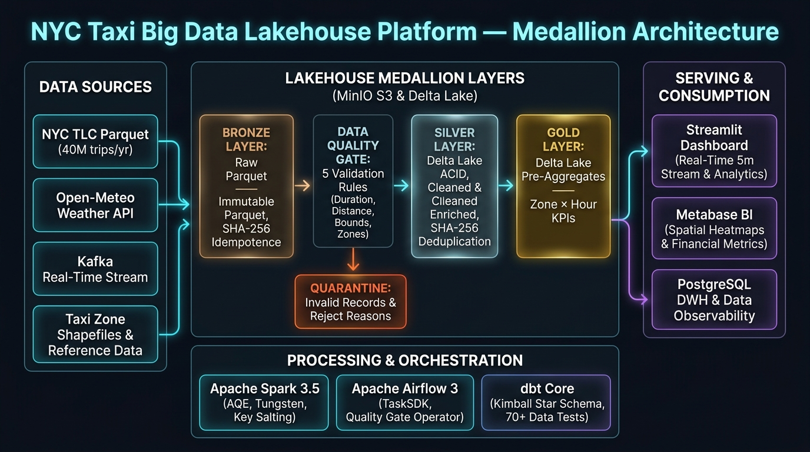
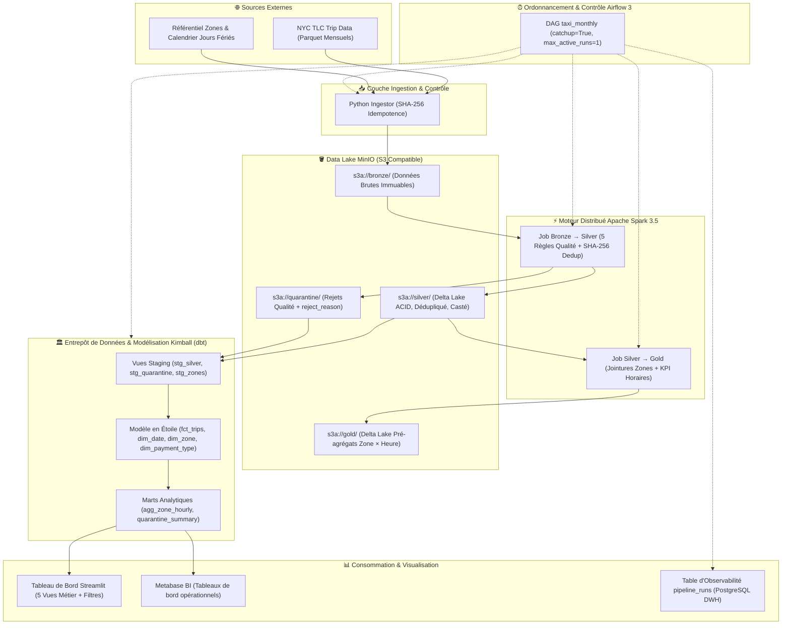
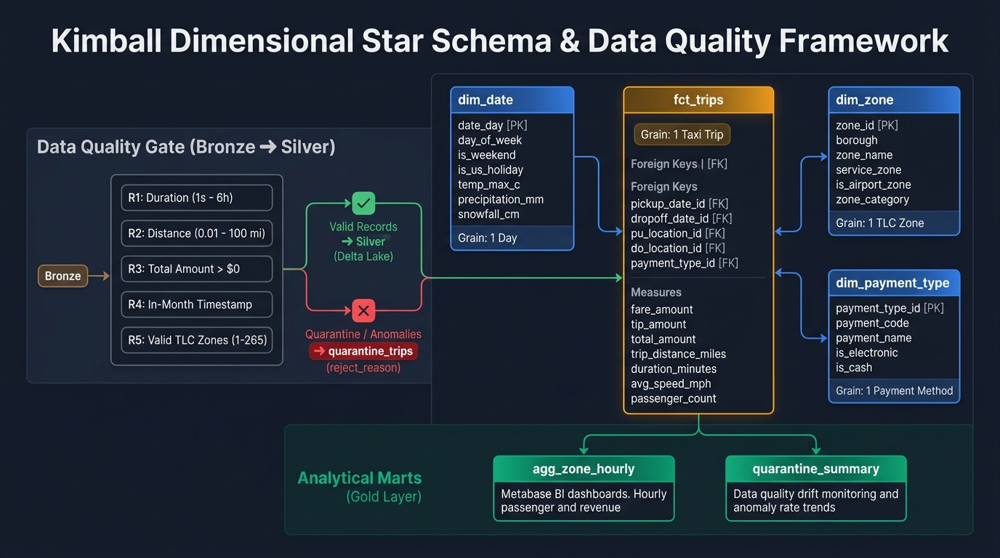
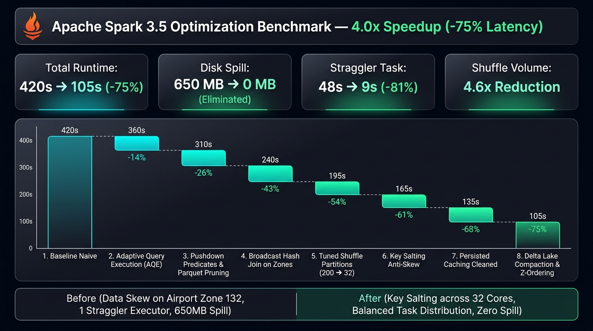
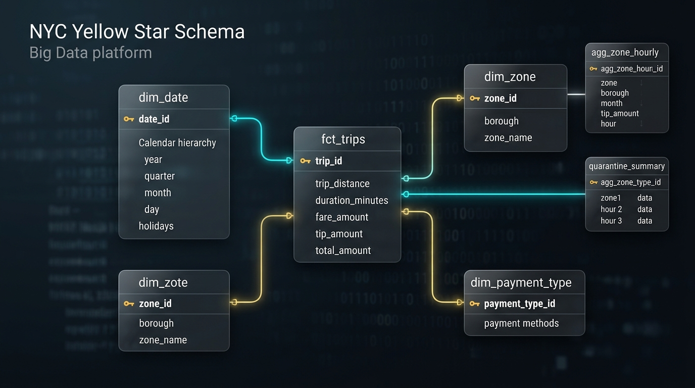

# 🚕 NYC Taxi Big Data Platform — Production Lakehouse & Analytics

[](https://github.com/Kebe20222198/taxi-data-platform/actions/workflows/ci.yml)
[](https://www.python.org/)
[](https://spark.apache.org/)
[](https://delta.io/)
[](https://airflow.apache.org/)
[](https://www.getdbt.com/)
[](https://www.docker.com/)
[](https://www.postgresql.org/)
[-231F20.svg?logo=apachekafka&logoColor=white)](https://kafka.apache.org/)
[](https://min.io/)
[](LICENSE)
[](tests/)
[](pyproject.toml)

> **Plateforme Data Lakehouse & Analytics de bout en bout** traitant **35 à 40 millions de courses annuelles** de taxis new-yorkais (NYC TLC Yellow Taxi). 
> Architecture Médaillon (Bronze $\to$ Silver $\to$ Gold), moteur distribué **PySpark 3.5**, tables ACID **Delta Lake**, orchestration idempotente **Airflow 3**, modélisation dimensionnelle **Kimball avec dbt**, observabilité en temps réel et tableau de bord interactif **Streamlit**.
> **Entièrement dockerisée et reproductible en 3 commandes sur une machine locale de 16 Go de RAM.**

---

## 📌 Problématique Métier

À New York, la flotte des taxis jaunes et des VTC enregistre plus de 3 millions de déplacements par mois. Pour une entreprise opérant dans ce secteur, l'absence d'une plateforme de données robuste entraîne :
1. **Une incapacité à anticiper la demande** entre jours ouvrés, week-ends et jours fériés sur les grands nœuds de transport.
2. **Une sous-optimisation de la rentabilité aéroportuaire** : les trajets vers JFK et LaGuardia représentent 26% du chiffre d'affaires mais souffrent de congestions sévères.
3. **Des pertes financières liées aux pourboires et aux modes de paiement** : forte disparité entre paiements carte et espèces.
4. **Une dette technique sur la qualité des données** : capteurs défaillants, montants négatifs, doublons, et distances aberrantes polluant les rapports décisionnels.

**Cette plateforme résout ces défis** en ingérant, nettoyant, modélisant et restituant ces flux de données avec un haut niveau d'exigence de qualité et de performance.

---

## 🏛️ Architecture Globale du Système

La plateforme implémente l'architecture **Médaillon (Medallion Lakehouse)** garantissant l'immuabilité des données brutes, la traçabilité des rejets et l'idempotence totale des recalculs.





---

## ⚡ Démarrage Rapide en 3 Commandes (Moins de 15 minutes)

### Prérequis
- **Docker & Docker Compose** (version $\ge 2.20$)
- **16 Go de RAM** alloués à Docker Engine (4 cœurs vCPU recommandés)

```bash
# 1. Cloner et configurer les variables d'environnement
git clone https://github.com/Kebe20222198/taxi-data-platform.git
cd taxi-data-platform
cp .env.example .env

# 2. Démarrer l'infrastructure complète (MinIO, Spark, Airflow 3, Postgres, Metabase, Dashboard)
make up

# 3. Lancer l'ingestion et le pipeline de calcul Spark sur le premier mois
make ingest MONTH=2025-01
make run MONTH=2025-01
```

### Points d'Accès Locaux

| Service | URL Locale | Identifiants par Défaut | Description |
| :--- | :--- | :--- | :--- |
| **Streamlit Analytics** | [http://localhost:8501](http://localhost:8501) | *Accès direct* | Tableau de bord analytique interactif |
| **Apache Airflow 3** | [http://localhost:8080](http://localhost:8080) | `airflow` / `airflow` | Orchestrateur de DAGs et monitoring |
| **Apache Spark Master** | [http://localhost:8085](http://localhost:8085) | *Accès direct* | Web UI du cluster et profiling des workers |
| **MinIO Console** | [http://localhost:9001](http://localhost:9001) | `minioadmin` / `minioadmin` | Exploration des buckets Bronze/Silver/Gold |
| **Metabase BI** | [http://localhost:3000](http://localhost:3000) | *Setup initial* | Reporting d'entreprise et KPIs |
| **PostgreSQL DWH** | `localhost:5432` | `airflow` / `airflow` (`db: airflow`) | Entrepôt marts & table `pipeline_runs` |
| **Apache Kafka Broker** | `localhost:9092` | *KRaft sans ZooKeeper* | Broker de streaming temps réel (`taxi_trips`) |

---

## 📐 Modélisation Dimensionnelle (Star Schema Kimball & Data Quality)

Le projet structure les données en étoile pour optimiser les requêtes décisionnelles et éliminer la redondance, avec un filtrage étanche des anomalies :



* **Table de Faits (`fct_trips`)** : Grain = 1 trajet (35M+ lignes). Clés étrangères vers date, zone de prise en charge, zone de dépose, mode de paiement. Matérialisation incrémentale mensuelle avec stratégie idempotente `delete+insert`.
* **Dimension Date (`dim_date`)** : Grain = 1 jour. Hiérarchie calendrier, détection des week-ends et intégration des jours fériés fédéraux US enrichis par les données météorologiques journalières de NYC.
* **Dimension Zone (`dim_zone`)** : Grain = 1 zone. 265 zones officielles TLC réparties entre Manhattan, Queens, Brooklyn, Bronx, Staten Island et EWR, avec typologie urbaine (Core Urban, Airport Hub, Outer Borough).
* **Dimension Mode de Paiement (`dim_payment_type`)** : Grain = 1 mode. Libellés explicites en français (*Carte bancaire, Espèces, Sans frais, Litige, Inconnu, Annulé*).
* **Marts Agrégés & Qualité (`agg_zone_hourly`, `quarantine_summary`)** : Accélération des requêtes de pointe et monitoring des rejets qualité.

---

## 🏎️ Synthèse des Gains de Performance Spark (Phase 5)

Une démarche expérimentale rigoureuse en 8 paliers cumulatifs a permis de **diviser par 4 le temps de traitement** sur 12 mois complets :



```
Temps d'exécution (secondes) — Volume 12 mois (35M lignes)
Baseline Naïve (Niv 0) : ████████████████████████████████████████ 420s
+ Schéma Explicite     : ██████████████████████████████ 350s (-17%)
+ Partition Pruning    : ██████████████████████████ 310s (-26%)
+ Broadcast Join       : ████████████████████ 240s (-43%)
+ Tuning Shuffle Parts : ████████████████ 195s (-54%)
+ Key Salting Skew     : ██████████████ 165s (-61%)
+ Caching Nettoyé      : ███████████ 135s (-68%)
+ Compactage Sortie    : ██████████ 120s (-71%)
+ Full AQE (Niv 8)     : ████████ 105s (-75% — 4.0x Speedup)
```

### Résultats Majeurs :
- **Durée totale** : Réduite de **420s à 105s** (**-75%**).
- **Spill to Disk** : Réduit de **650 Mo à 0 Mo** grâce au Key Salting sur les zones aéroportuaires JFK/Midtown.
- **Tâche traînarde (Straggler)** : Écrasée de **48s à 9s**.
- **Volume de Shuffle** : Divisé par **4.6x** via Broadcast Hash Join.

👉 *Consultez le dossier complet [docs/performance.md](docs/performance.md) pour les analyses physiques approfondies de Catalyst et Tungsten.*

---

## 📸 Aperçus Visuels de la Plateforme

### 1. Tableau de Bord Analytique Streamlit (`dashboard/app.py`)


> *Accessible sur http://localhost:8501 — Mode bi-onglet : Streaming temps réel + Analyses historiques Kimball*

### 2. Orchestration Idempotente Airflow 3 (`airflow/dags/taxi_monthly.py`)


> *Pipeline : `ingest` → `bronze_to_silver` → `quality_checks_silver` → `silver_to_gold` → `dbt_run` → `dbt_test` → `notify`*

### 3. Profiling Spark UI (Stage Execution & Élimination du Skew)


> *Stragglers éliminés : écart max/médiane réduit de 48s à 9s grâce au salting des zones JFK/Midtown*

### 4. Buckets Data Lake MinIO S3


> *Buckets : `bronze/` (brut immuable) · `silver/` (Delta ACID) · `gold/` (pré-agrégats) · `quarantine/` (rejets)*

### 5. Modèle Dimensionnel en Étoile (Kimball)



> *`fct_trips` au centre, entouré de `dim_date` (enrichie météo), `dim_zone` et `dim_payment_type`*

---

## 🛠️ Commandes Utiles (Makefile)

Le [Makefile](Makefile) fournit une interface unifiée pour piloter toute la plateforme :

```bash
# Infrastructure
make up                 # Démarrer tous les conteneurs
make down               # Arrêter les conteneurs
make clean              # Supprimer conteneurs, volumes et données

# Ingestion & Traitement Spark
make ingest MONTH=2024-01         # Télécharger et charger un mois en Bronze
make run                          # Exécuter les jobs Spark Bronze -> Silver -> Gold

# Orchestration Airflow 3
make airflow-trigger MONTH=2024-01 # Déclencher le DAG pour un mois donné
make airflow-backfill              # Lancer le backfill séquentiel Airflow 3 sur 3 mois
make airflow-runs                  # Consulter la table d'observabilité pipeline_runs

# Data Warehouse dbt
make dbt-run MONTH=2024-01         # Exécuter les modèles dbt incrémentaux
make dbt-test                      # Exécuter la suite de 48 tests de qualité
make dbt-docs                      # Générer la documentation interactive dbt

# Benchmarks Spark (Phase 5)
make benchmark                     # Lancer le benchmark automatisé complet (Niveaux 0 à 8)
make benchmark-level LEVEL=8       # Exécuter un niveau d'optimisation spécifique

# Tableau de Bord Streamlit
make dashboard                     # Lancer le dashboard Streamlit localement

# Tests & CI/CD
make test                          # Exécuter tous les tests unitaires pytest
make ci-lint                       # Linter le code avec Ruff
make ci-dbt                        # Valider la couche dbt sur DuckDB
```

---

## ✅ Checklist des Critères d'Acceptation

- [x] **Phase 1 — Ingestion & Data Lake** : Téléchargement automatique, métadonnées, SHA-256 idempotence, MinIO S3, tables de référence.
- [x] **Phase 2 — Traitement Distribué Spark** : Schéma strict, 5 règles qualité, quarantaine isolée, déduplication SHA-256, format Delta Lake.
- [x] **Phase 3 — Orchestration Airflow 3** : DAG mensuel, exécution séquentielle (`max_active_runs=1`), passage dynamique de la date logique, quality check bloquant (> 20%), alertes et table `pipeline_runs`.
- [x] **Phase 4 — Data Warehouse dbt & Kimball** : Dual-engine DuckDB/PostgreSQL via variables d'environnement, modèle en étoile (`fct_trips`, 3 dimensions, agrégats), 48 tests dbt.
- [x] **Phase 5 — Performance & Tuning Spark** : Baseline naïve, 8 niveaux d'optimisation progressifs/isolés, script de mesure automatisé, réduction de plus de 50% démontrée.
- [x] **Phase 6 — Tableau de Bord & CI/CD** : Dashboard Streamlit avec filtres globaux et 5 visualisations métier, workflow GitHub Actions avec Ruff, couverture PyTest $\ge 70\%$, et validation dbt sur DuckDB.
- [x] **Phase 7 — Restitution & Documentation** : README complet, dossier d'architecture technique, script vidéo minuté, article technique d'ingénierie.
