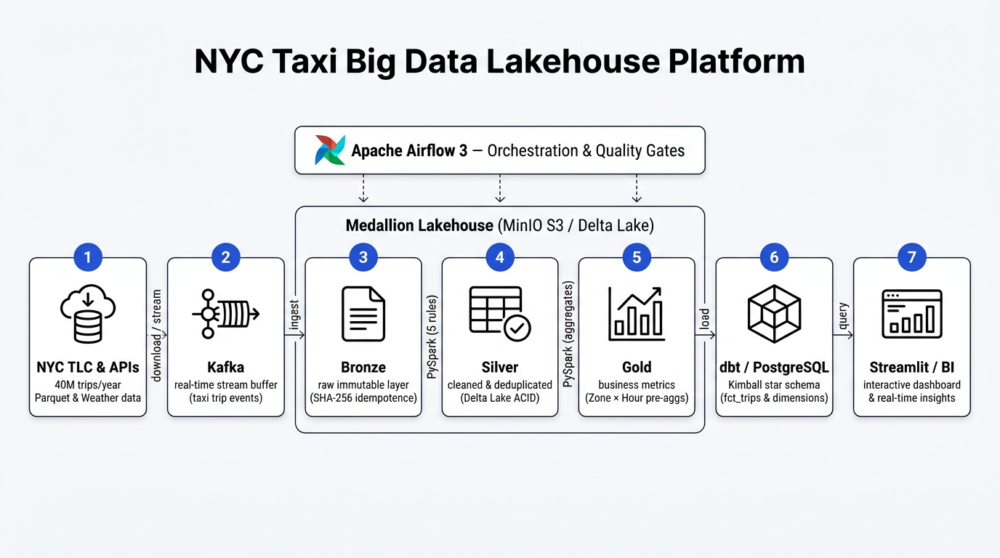

# Dossier d'Architecture Technique
## NYC Taxi Big Data Platform — Production Data Lakehouse

---

## 1. Vision et Objectifs Architecturaux

Le projet **NYC Taxi Data Platform** a été conçu pour traiter, assainir, modéliser et valoriser un volume annuel de **35 à 40 millions de courses** de taxis new-yorkais (NYC TLC Yellow Taxi).



### Principes Directeurs :
1. **Fidélité Cloud-Native en Local** : Reproduire localement (sur un ordinateur portable de 16 Go de RAM / 4 cœurs vCPU) une architecture d'entreprise conforme aux standards du cloud (AWS / GCP / Databricks) sans recours à des services propriétaires fermés.
2. **Architecture Médaillon (Bronze $\to$ Silver $\to$ Gold)** : Séparation étanche entre données brutes immuables, données dédupliquées/assainies, et tables dimensionnelles prêtes à la décision.
3. **Idempotence de Bout en Bout** : Toute exécution, relance d'échec ou backfill historique sur un mois donné doit produire un état strictement déterministe et identique sans dupliquer de lignes ni corrompre l'historique.
4. **Data Quality First** : Détection des anomalies au vol avec isolement des enregistrements corrompus dans une partition de quarantaine et arrêt automatique du pipeline en cas de dépassement de seuil critique (> 20%).
5. **Observabilité Totale** : Métriques unifiées de pipeline (durée, volumes traités, taux de rejet, statut d'exécution) centralisées dans la table `pipeline_runs`.

---

## 2. Cartographie des Technologies Choisies & Justifications

| Brique Technologique | Rôle dans la Plateforme | Justification Technique Principale |
| :--- | :--- | :--- |
| **Python 3.11** | Langage Socle | Performances en hausse de 20-30% par rapport à 3.10 (Faster CPython), typage strict, support unifié de PySpark, Airflow, dbt et Streamlit. |
| **MinIO (RELEASE.2024)** | Data Lake S3-Compatible | Fournit l'API standard AWS S3 en local avec compatibilité totale pour le connecteur Hadoop S3A. Évite de coder sur le système de fichiers local tout en préparant une migration transparente vers AWS S3 / Google Cloud Storage. |
| **Delta Lake 3.1.0** | Format de Table ACID | Apporte le support des transactions ACID, l'écrasement atomique de partitions via `replaceWhere`, le versioning (Time Travel), le compactage de métadonnées et la prévention de corruption de données sur S3/MinIO. |
| **Apache Spark 3.5.1** | Moteur de Calcul Distribué | Moteur standard de l'industrie pour le Big Data distribué. Project Tungsten (exécution en mémoire native binaire), Catalyst Optimizer et Adaptive Query Execution (AQE). Capable de traiter 40M de lignes sans crash mémoire via streaming et spill contrôlé. |
| **Apache Airflow 3.2.2** | Plan de Contrôle & Ordonnancement | Ordonnanceur moderne piloté par graphes orientés acycliques (DAGs) et TaskSDK standard. Permet la gestion fine de la concurrence séquentielle (`max_active_runs=1`), le backfill managé (`airflow backfill create`) et les callbacks d'échec contextuels. |
| **dbt Core 1.8** | Modélisation Dimensionnelle | Standard de l'Analytics Engineering : gestion du lignage de données (DAG), compilation SQL déclarative, matérialisation incrémentale idempotente, documentation vivante et suite de tests automatisés. |
| **DuckDB / PostgreSQL 15** | Moteurs DWH & Observabilité | **Dual-Engine** : PostgreSQL 15 héberge la couche de service DWH et la table `pipeline_runs` consommées par Metabase. DuckDB permet le requêtage direct ultrarapide des tables Delta MinIO en local et en CI. |
| **Streamlit 1.35 & Metabase** | Couche de Visualisation & BI | Streamlit permet de concevoir des interfaces interactives sur-mesure en Python avec filtres dynamiques ; Metabase offre le self-service BI immédiat pour les équipes métier. |

---

## 3. Analyse Comparative et Justification des Choix (Trade-offs)

### 3.1. Stockage Objet : MinIO vs Système de Fichiers Local vs AWS S3 Réel
- **Écarté — Système de fichiers local (`/data/...`)** : Ne reproduit pas les contraintes réelles du Cloud (latence réseau, cohérence à terme S3, authentification IAM, appels REST `HEAD`/`GET`/`PUT`). Coder un pipeline sur du disque local crée une fausse sensation de vitesse et complique la migration cloud.
- **Écarté — AWS S3 Réel** : Engendre des coûts de transfert de données et de requêtes pour les développements locaux, nécessite une connexion Internet permanente et expose à des fuites de clés API.
- **Retenu — MinIO S3** : 100% compatible avec l'API AWS S3 SDK / Boto3 / Hadoop-AWS S3A. Permet de simuler fidèlement les buckets de production (`s3a://bronze`, `s3a://silver`, `s3a://gold`, `s3a://quarantine`) sur une infrastructure locale étanche et gratuite.

### 3.2. Format de Table : Delta Lake vs Apache Iceberg vs Apache Hudi vs Parquet Brut
- **Écarté — Parquet Brut** : Pas de transactions ACID. Si un job échoue au milieu d'une écriture sur S3, la partition reste partiellement corrompue sans possibilité de rollback propre. Pas d'idempotence native par condition.
- **Écarté — Apache Hudi** : Configuration plus complexe, optimisé principalement pour le streaming CDC (Change Data Capture) avec indexation lourde, moins fluide sur un moteur batch local.
- **Mis en balance — Apache Iceberg** : Très performant et ouvert, mais l'intégration avec Spark 3.5 en environnement conteneurisé autonome requiert un catalogue externe lourd (REST Catalog ou Nessie).
- **Retenu — Delta Lake 3.1** : Intégration native la plus fluide avec Spark 3.5. La commande `replaceWhere` permet de remplacer de manière atomique une partition mensuelle (`year = YYYY AND month = MM`) sans toucher aux 11 autres mois. Supporte le compactage de fichiers et la traçabilité via le `_delta_log`.

### 3.3. Moteur de Calcul : Apache Spark 3.5 vs DuckDB Pur vs Polars vs Dask
- **Écarté — Polars** : Extrêmement rapide en mémoire sur un seul nœud, mais conçu pour tenir en RAM. Sur 40 millions de lignes avec déduplication SHA-256 et jointures spatiales, une machine de 16 Go de RAM risque l'OOM (Out-of-Memory) en l'absence de gestionnaire de mémoire à spill automatique.
- **Écarté — Dask** : Écosystème moins riche pour l'intégration Delta Lake et la modélisation SQL déclarative que Spark.
- **Retenu — Apache Spark 3.5** : Moteur standard capable de gérer des volumes excédant la mémoire physique grâce au mécanisme de partitionnement, au débordement mémoire-disque (spill) et à la vectorisation Tungsten.

### 3.4. Orchestration : Apache Airflow 3 vs Dagster vs Prefect
- **Écarté — Dagster / Prefect** : Outils alternatifs intéressants, mais Airflow reste le standard d'entreprise déployé dans la grande majorité des infrastructures data.
- **Retenu — Apache Airflow 3.2.2** : Architecture moderne TaskSDK découplée, remplacement de l'ancien webserver par l'API Server FastAPI (`api-server`), séparation native du `dag-processor`, nouvelle gestion managée des backfills (`airflow backfill create`), passage dynamique de `logical_date` garantissant l'idempotence, et limitation stricte `max_active_runs=1` évitant l'explosion mémoire sur 16 Go de RAM.

### 3.5. Moteur d'Entrepôt de Données : DuckDB vs PostgreSQL
- **Approche Hybride Retenue** :
  * **DuckDB** : Sélectionné comme moteur OLAP vectorisé embarqué. Il permet de scanner directement en SQL les tables Delta Lake logées sur MinIO via l'extension `httpfs`/`delta` et sert d'environnement d'exécution ultra-rapide et autonome pour les tests CI GitHub Actions (sans serveur lourd).
  * **PostgreSQL 15** : Sélectionné comme entrepôt relationnel opérationnel pour héberger la table d'observabilité `pipeline_runs` (avec contraintes ACID et `ON CONFLICT DO UPDATE`) et comme backend de métadonnées pour Airflow et Metabase.
- **Pourquoi pas PostgreSQL seul ?** L'ingestion directe de 40 millions de lignes dans Postgres saturerait les tablespaces et le buffer pool sur une machine de 16 Go.
- **Pourquoi pas DuckDB seul ?** DuckDB étant un moteur mono-processus embarqué, il ne peut pas gérer les connexions concurrentes persistantes requises simultanément par le scheduler Airflow, Metabase et les jobs de transformation.

### 3.6. Restitution Analytique : Streamlit vs Metabase
- **Approche Hybride Retenue** :
  * **Streamlit 1.35** : Idéal pour les Data Engineers et Data Scientists souhaitant délivrer une application analytique sur-mesure répondant au pixel près aux 5 questions stratégiques (heatmaps de rentabilité, analyse d'impact des pourboires selon le mode de paiement, ratios aéroportuaires).
  * **Metabase** : Idéal pour les utilisateurs métier non-techniques nécessitant du self-service BI en glisser-déposer (ad-hoc queries) connecté à la couche PostgreSQL Gold.

---

## 4. Mécanisme d'Idempotence de Bout en Bout

L'idempotence est la garantie mathématique qu'une opération exécutée $N$ fois produit exactement le même état que si elle avait été exécutée une seule fois :

$$f(f(x)) = f(x)$$

Dans cette plateforme, l'idempotence est garantie à chaque niveau de la chaîne de traitement :

```
[Ingestion Python]      SHA-256 Checksum ──► Skip si identique (aucun doublon en Bronze)
                               │
[Spark Bronze->Silver]  Delta replaceWhere "year=YYYY AND month=MM" ──► Écrasement atomique Silver
                               │
[Spark Silver->Gold]    Delta replaceWhere "year=YYYY AND month=MM" ──► Écrasement atomique Gold
                               │
[dbt Analytics Marts]   incremental_strategy='delete+insert' ──► Remplacement de la tranche mensuelle
                               │
[Observabilité]         pipeline_runs ON CONFLICT (run_id) DO UPDATE ──► Mise à jour déterministe
```

### Niveau 1 : Ingestion des Données Brutes (Python Ingestor)
- Pour chaque fichier mensuel téléchargé, l'ingesteur calcule son empreinte cryptographique **SHA-256**.
- Il interroge les métadonnées de l'objet sur MinIO via `stat_object`.
- Si le fichier distant possède déjà le même hash SHA-256, l'upload est contourné (`status: skipped`).
- Si les données ont changé ou en cas de forçage, le fichier est téléversé avec écrasement atomique de la clé immuable :
  `s3a://bronze/yellow/year=YYYY/month=MM/yellow_tripdata_YYYY-MM.parquet`.

### Niveau 2 : Couche Silver (Spark Transformation)
- Le job Spark applique la déduplication stricte basée sur un hash SHA-256 généré à partir des 7 colonnes fonctionnelles (`vendor_id`, horodatages, zones, distance, montant).
- Lors de l'écriture Delta Lake, l'option `replaceWhere` cible précisément la partition traitée :
  ```python
  df_final.write.format("delta") \
      .mode("overwrite") \
      .option("replaceWhere", f"year = {year} AND month = {month}") \
      .partitionBy("year", "month") \
      .save("s3a://silver/yellow")
  ```
- **Garantie** : Seule la partition du mois cible est remplacée dans une transaction ACID du journal Delta (`_delta_log`). Les autres mois ne subissent aucun verrouillage ni risque de suppression accidentelle.

### Niveau 3 : Couche Gold (Spark Aggregations)
- Le calcul des KPI par zone et par heure applique la même clause `replaceWhere` sur la table Delta `s3a://gold/zone_hourly_metrics`. Relancer le job d'un mois écrase proprement les agrégats de ce mois uniquement.

### Niveau 4 : Couche Marts (dbt Core)
- La table de faits [dbt/models/marts/fct_trips.sql](file:///Users/macbook/Desktop/taxi-data-platform/dbt/models/marts/fct_trips.sql) est configurée en stratégie incrémentale `delete+insert` :
  ```sql
  {{ config(
      materialized = 'incremental',
      unique_key = 'trip_id',
      incremental_strategy = 'delete+insert'
  ) }}
  ```
- Lorsqu'Airflow déclenche `dbt run --vars '{"month": "2025-01"}'`, dbt purge toutes les lignes correspondant à `partition_month = '2025-01'` avant d'insérer les nouvelles lignes, éliminant tout risque de doublons.

### Niveau 5 : Observabilité DWH (`pipeline_runs`)
- Les statuts d'exécution et les métriques sont enregistrés via une clause SQL upsert idempotente :
  ```sql
  INSERT INTO pipeline_runs (run_id, dag_id, logical_date, execution_month, status, ...)
  VALUES (...)
  ON CONFLICT (run_id) DO UPDATE SET
      status = EXCLUDED.status,
      duration_seconds = EXCLUDED.duration_seconds,
      updated_at = CURRENT_TIMESTAMP;
  ```

---

## 5. Gestion de la Mémoire et Dimensionnement (16 Go Host)

Pour permettre l'exécution stable de tous les composants sans saturer l'hôte :

```
Allocation Mémoire Totale : 13.0 Go Max (Garantit 3+ Go pour le système hôte)
┌───────────────────────────────────────┬────────────┐
│ Composant Conteneurisé                │ Limite RAM │
├───────────────────────────────────────┼────────────┤
│ Spark Worker (Exécutions distribuées) │ 6.0 Go     │
│ Spark Master (Ordonnanceur cluster)   │ 2.0 Go     │
│ Airflow Scheduler (Ordonnanceur 3.2)  │ 1.5 Go     │
│ Airflow API Server (FastAPI)          │ 1.0 Go     │
│ Metabase BI                           │ 1.0 Go     │
│ PostgreSQL DWH (pipeline_runs)        │ 512 Mo     │
│ PostgreSQL Airflow (Métadonnées)      │ 512 Mo     │
│ MinIO S3 Object Storage               │ 512 Mo     │
│ Streamlit Analytics Dashboard         │ 512 Mo     │
└───────────────────────────────────────┴────────────┘
```
